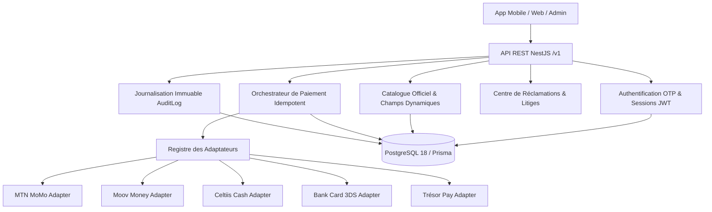

# Architecture Technique du Système — Paiement BJ

**Version :** 1.0.0  
**Architecture :** Monorepo Modulaire (Mobile Android/iOS, Web, API NestJS, Back-Office Admin)  

---

## 1. Vue d'Ensemble du Monorepo

```text
paiementbj/
├── apps/
│   ├── mobile/          # Application mobile & web universelle (Expo SDK 58 + Expo Router)
│   ├── api/             # Backend REST & Orchestration (NestJS + Prisma ORM + Swagger)
│   └── admin/           # Console d'administration et gouvernance (React + Vite)
├── packages/
│   ├── types/           # Interfaces TypeScript partagées entre front & back
│   ├── shared/          # Logique métier pure (Téléphone Bénin +229, FCFA, Contrastes WCAG)
│   ├── schemas/         # Validation stricte Zod pour formulaires et API
│   ├── ui/              # Design System institutionnel WCAG 2.2 AAA
│   ├── api-client/      # Client HTTP fortement typé
│   └── config/          # Configurations partagées
├── assets/
│   └── brands/          # Logos officiels des marques et organismes stockés localement
└── docs/                # Rapports d'audit, ADR, sécurité, intégrations, inventaire de marques
```

---

## 2. Architecture Logique Backend



---

## 3. Flux Transactionnel Sécurisé

1. **Intention de paiement (`POST /v1/payments/intents`)** :
   - Soumise avec une **clé d'idempotence UUID v4**.
   - Vérifie l'intégrité du service dans le catalogue.
   - Génère une référence unique `PBJ-YYYYMMDD-XXXXX`.
2. **Tentative de débit (`POST /v1/payments/attempts`)** :
   - Interroge l'adaptateur prestataire sélectionné.
   - Si le connecteur est configuré, initie la session auprès du prestataire (ex: RequestToPay USSD).
   - Sinon, renvoie un état explicite d'indisponibilité.
3. **Vérification & Justificatif** :
   - Aucune transaction n'est marquée `SUCCEEDED` sans confirmation serveur du prestataire.
   - Une fois confirmée, un reçu officiel `REC-BJ-YYYY-XXXXX` est généré avec une empreinte cryptographique **SHA-256**.
