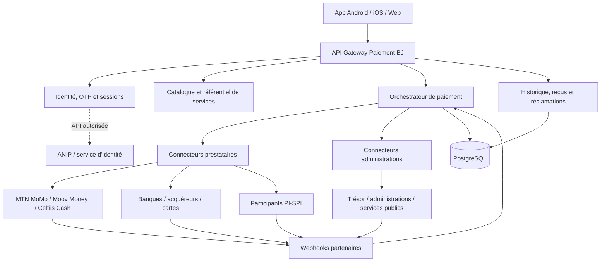

# Paiement BJ — Plan de développement du MVP

**Version :** 0.1 · **Date :** 10 novembre 2026  
**Produit :** application mobile d'interopérabilité et de centralisation des parcours de paiement  
**Décision structurante :** aucun portefeuille Paiement BJ et aucune conservation des fonds des utilisateurs.

---

## 1. Vision et périmètre

Paiement BJ est une porte d'entrée mobile qui permet de trouver un service, préparer un paiement, sélectionner un prestataire existant, suivre le statut et retrouver le justificatif dans un espace unique.

L'application ne crée pas de solde, ne reçoit pas de dépôt, ne détient pas de monnaie électronique et ne devient pas un établissement financier. Les fonds restent chez la banque, l'émetteur de monnaie électronique ou le prestataire qui exécute le paiement.

### Promesse produit

> Un seul espace pour retrouver, préparer et suivre ses paiements, avec les moyens de paiement que l'on utilise déjà.

### Trois avantages concurrentiels

1. **Une application mobile de référence** : installation sur le téléphone, accès rapide, notifications, parcours cohérents et présence permanente. L'application mobile est le produit principal, avec un accès web complémentaire.
2. **Simplicité et centralisation** : même logique de recherche, mêmes étapes, frais présentés avant validation, historique et reçus regroupés.
3. **Sécurité et traçabilité** : authentification proportionnée, validation par le prestataire, statuts vérifiables, références uniques, reçus et suivi des réclamations.

Les usages touristes, diaspora, cartes étrangères et paiement international constituent un axe de différenciation supplémentaire, mais ne doivent pas bloquer le MVP national.

### Ce que Paiement BJ n'est pas

- Pas un portefeuille électronique.
- Pas une nouvelle monnaie.
- Pas un compte bancaire.
- Pas un agrégateur universel de soldes par défaut.
- Pas un substitut à la PNPE, à PI-SPI, aux banques ou aux opérateurs Mobile Money.
- Pas un système permettant d'accéder librement aux bases ANIP/RAVIP.

---

## 2. Socle technique retenu

### Application multiplateforme

| Couche | Choix | Justification |
|---|---|---|
| Application | **Expo SDK 58 + React Native 0.88 + TypeScript** | Une base de code Android, iOS et Web ; priorisation Android sans bloquer iOS et Web |
| Navigation | **Expo Router 58** | Routage par fichiers, liens profonds, navigation native et Web |
| État client | Zustand 5 | État léger pour session, préférences et parcours en cours |
| État serveur | TanStack Query | Cache, rafraîchissement, mutations, reprise et gestion d'état réseau |
| Formulaires | React Hook Form + Zod | Validation cohérente côté interface et schémas réutilisables |
| Animations | React Native Animated (socle MVP), Reanimated 4 si gestes/animations complexes | Transitions légères sans dépendance supplémentaire ; Reanimated pour les interactions avancées |
| Sécurité locale | expo-secure-store, expo-local-authentication | Jetons de session et déverrouillage biométrique local, jamais collecte d'empreinte brute |
| Notifications | expo-notifications, via backend | Confirmation de paiement, statuts, alertes et rappels avec consentement |

**Versions de référence au 10 novembre 2026 :** React Native 0.88.1 est la branche courante active ; Expo SDK 58 et Expo Router 58 sont documentés pour les applications universelles. Initialiser avec le modèle SDK 58 explicite plutôt que de supposer que `@latest` pointe déjà sur ce SDK pendant sa période de transition. Sources : [matrice React Native/Expo](https://reactnative.dev/), [Expo Router](https://docs.expo.dev/versions/v58.0.0/sdk/router/), [démarrage Expo SDK 58](https://docs.expo.dev/router/introduction/).

### Backend recommandé pour la production

| Couche | Choix recommandé |
|---|---|
| API | NestJS 12 + TypeScript, Fastify si validé par les besoins d'exploitation |
| Base transactionnelle | PostgreSQL 18 |
| Cache / verrous / limitation | Redis |
| Tâches asynchrones | BullMQ ou file équivalente pour webhooks, reçus, notifications et rapprochement |
| Contrat d'API | OpenAPI 3.1, versionnement `/v1` |
| Authentification | OTP côté serveur, jetons de courte durée, rotation et révocation des sessions |
| Observabilité | OpenTelemetry, métriques, journaux structurés, alerting et tableau d'incidents |
| Déploiement | Infrastructure validée par l'État / l'opérateur, environnements séparés et sauvegardes testées |

NestJS 12 est disponible depuis août 2026 et PostgreSQL 18 est la version majeure courante en novembre 2026. Sources : [compatibilité NestJS](https://docs.nestjs.com/faq/versions), [PostgreSQL versioning](https://www.postgresql.org/support/versioning/).

### Pourquoi Expo plutôt qu'une application web emballée

- Android est réellement natif, et non une simple page web dans une WebView.
- Les modules appareil (notifications, stockage sécurisé, biométrie locale, liens profonds, caméra/QR) sont accessibles.
- Le même socle React Native est réutilisable sur iOS et Web.
- Les versions Android, iOS et Web évoluent depuis un même dépôt.
- Les fonctions sensibles pourront s'appuyer sur un développement natif contrôlé si un partenaire l'exige.

Le Web doit rester une déclinaison de la même expérience, pas l'architecture principale. Sous Windows 11, le développement et les builds Android/Web sont accessibles localement ; la compilation iOS de distribution exige un environnement macOS/Xcode ou un build cloud EAS.

---

## 3. Charte graphique tirée de la capture officielle

La capture du portail du Prix national sert de référence visuelle. Il faut reprendre ses codes, sans copier à l'identique la page institutionnelle : vert profond, arrière-plans végétaux très pâles, blanc, jaune solaire, typographie ronde et forte, cartes aérées et boutons sobres.

### Palette de travail

Les valeurs ci-dessous sont des tokens de conception approximés à partir de la capture, à confirmer par prélèvement de pixels/Figma pendant le design final.

| Token | Valeur | Usage |
|---|---|---|
| `primary` | `#064B32` | CTA, navigation active, surfaces fortes |
| `primaryDeep` | `#003F2B` | Fonds de cartes principales / états pressés |
| `text` | `#123B2F` | Titres et textes principaux |
| `background` | `#F5F8F4` | Fond global de l'application |
| `backgroundMint` | `#EAF2EC` | Sections secondaires, bandeaux |
| `primarySoft` | `#E8F1EA` | Icônes, informations de sécurité |
| `surface` | `#FFFFFF` | Cartes, champs, feuilles modales |
| `accent` | `#FFC52C` | Accent solaire, surlignage, action secondaire forte |
| `accentSoft` | `#FFF4D2` | Fond d'information accentué |
| `muted` | `#708178` | Descriptions et métadonnées |
| `border` | `#E2EAE3` | Bordures discrètes |
| `success` | `#1B8752` | Confirmation réelle uniquement |
| `warning` | `#B7791F` | Attention, étape non disponible |
| `danger` | `#C74646` | Échec, erreur et action destructive |

### Typographie

- Titres : **Outfit**, poids 600 à 900, très peu de lettres capitales (chargée dans le starter).
- Corps : **DM Sans**, poids 400 à 900 selon la hiérarchie (chargée dans le starter).
- Métadonnées : DM Sans 500, 10 à 12 px sur Web, tailles équivalentes en dp sur mobile.
- Les montants sont tabulaires et toujours accompagnés de la devise.
- Éviter les textes intégralement en capitales sauf les petits libellés de contexte.

### Échelle et composants

| Élément | Règle |
|---|---|
| Marges écran | 20 dp mobile, 24–32 dp tablette/Web |
| Grille | 4 dp ; espaces usuels 8, 12, 16, 24 et 32 dp |
| Rayon | 10 dp champs, 14 dp cartes secondaires, 20–26 dp cartes principales |
| Bouton principal | 52–56 dp de haut, vert profond, texte blanc 700/800 |
| Bouton secondaire | Fond blanc, bordure vert/gris pâle, texte vert |
| Champs | 52 dp, fond blanc, bordure très discrète, libellé au-dessus |
| Cartes | Blanc, bordure fine, ombre douce, padding 14–18 dp |
| Navigation | Barre basse à 4 entrées : Accueil, Services, Activité, Profil |
| Logo opérateur | Toujours dans une boîte blanche ou neutre, image non déformée, taille homogène |

### Règles d'expérience

- Une action principale par écran.
- Ne pas faire défiler une succession de cartes décoratives avant l'action utile.
- La somme, le bénéficiaire, les frais et le moyen de paiement doivent être visibles avant de quitter Paiement BJ.
- Les statuts utilisent une couleur et un libellé textuel, jamais la couleur seule.
- Les erreurs doivent donner une action corrective claire.
- Afficher « Paiement en cours » tant que le serveur partenaire n'a pas confirmé l'opération.

### Microanimations

- Entrée d'écran : fondu léger + translation verticale de 6–10 dp, 180–240 ms (implémenté avec `Animated` dans le starter).
- Pression d'un bouton : échelle 0,98 et opacité légère, 100–140 ms ; préférer les feedbacks natifs et éviter les animations qui bloquent les actions.
- Sélection de fournisseur : contour/indicateur animé, 140–180 ms.
- Confirmation : icône qui apparaît avec ressort léger, 240–320 ms.
- Chargement : indicateur discret et libellé de progression ; pas de loader infini sans explication.
- Préférences d'accessibilité : respecter `reduce motion` et désactiver les animations non essentielles.
- Pas de parallaxe, de mouvement décoratif permanent ou de transitions qui retardent le paiement.

---

## 4. Architecture de navigation et écrans

### Navigation principale

1. **Accueil** : recherche, catégories rapides, services populaires, moyens de paiement reconnus, dernière activité.
2. **Services** : catalogue complet, recherche, catégories et filtres.
3. **Activité** : paiements, statuts, reçus, détails, filtres et recherche.
4. **Profil** : numéro, niveau d'identification, sécurité, langues, accessibilité, aide et confidentialité.

### Écrans secondaires

| Écran | Fonction |
|---|---|
| Inscription / connexion | Numéro de téléphone, consentements et code OTP |
| Vérification OTP | Validation d'un code unique, limite de tentatives et renvoi contrôlé |
| Service détail | Référence client, montant ou sélection de facture, validation de données |
| Récapitulatif | Bénéficiaire, référence masquée, montant, frais et conditions |
| Choix du prestataire | MTN MoMo, Moov Money, Celtiis Cash, banque ou carte selon disponibilité |
| Autorisation partenaire | Redirection ou SDK du prestataire, sans saisie de PIN sensible dans Paiement BJ |
| Résultat transaction | Confirmation attestée par le backend, référence unique et reçu |
| Détail transaction | Timeline d'état, preuve, télécharger/partager/imprimer, assistance |
| Identité | NPI vérifié via service ANIP officiellement habilité, seulement si nécessaire |
| Transfert interopérable | Flux partenaire/PI-SPI en phase ultérieure, sans solde Paiement BJ |
| Voyageurs / diaspora | Langue, cartes étrangères et information de change en phase ultérieure |
| Assistance / réclamation | Choix d'une transaction, motif, pièces et statut de dossier |

---

## 5. Parcours utilisateur

### A. Découverte et première utilisation

1. L'utilisateur installe l'application ou ouvre le Web.
2. Il voit la proposition de valeur et les principaux services.
3. Il peut parcourir le catalogue sans fournir immédiatement toutes ses données.
4. Il saisit son numéro au moment où il souhaite initier un parcours nécessitant un compte.
5. Il reçoit et vérifie un OTP.
6. Le profil reçoit un niveau de confiance initial lié au téléphone, pas une identité nationale certifiée.

### B. Paiement d'une facture

1. Accueil → Factures → SBEE/SONEB.
2. Saisie de la référence ou consultation de facture via connecteur officiel.
3. Vérification du nom ou de l'adresse du bénéficiaire, de la référence et du montant.
4. Affichage des frais et du total avant validation.
5. Choix du moyen de paiement compatible.
6. Redirection/SDK du prestataire et authentification chez celui-ci.
7. Retour à Paiement BJ avec un état non ambigu.
8. Confirmation après réception de la preuve serveur/webhook, puis reçu.
9. Transaction consultable dans Activité.

### C. Paiement administratif

1. Accès à Services publics.
2. Sélection du service ou de la démarche.
3. Saisie de la référence officielle générée par le service public.
4. Vérification du montant et de l'affectation.
5. Contrôle d'identité renforcé uniquement si le service ou la réglementation l'exige.
6. Paiement auprès du prestataire désigné par l'administration.
7. Confirmation du Trésor ou du système bénéficiaire ; reçu et rapprochement.

### D. Transaction en attente ou échouée

- Ne jamais proposer immédiatement une nouvelle tentative si l'état du premier débit est inconnu.
- Interroger le prestataire par référence de transaction.
- Présenter « Vérification en cours » jusqu'à résolution.
- Prévenir les doubles paiements par clé d'idempotence et contrôle d'état.
- Offrir une action « Signaler un problème » reliée à la transaction.
- En cas de débit sans crédit bénéficiaire, créer un dossier de rapprochement et appliquer les règles de remboursement du prestataire.

### E. Transfert vers un proche

Ce parcours est prévu comme extension : Paiement BJ ne stocke pas les fonds. L'ordre est soumis directement au prestataire ou au service PI-SPI accessible via un participant autorisé. Les règles de frais, de plafond, de confirmation du bénéficiaire et d'authentification proviennent du service exécutant.

### F. Voyageur / diaspora

- Choix de langue et de pays de résidence.
- Paiement par carte étrangère uniquement via un acquéreur/partenaire adapté.
- Conversion et devise affichées avant autorisation, sans taux inventé par Paiement BJ.
- Accès aux paiements publics et partenaires depuis l'étranger, lorsque les services acceptent ces cartes.
- Vérifications anti-fraude, change et transferts internationaux confiés aux partenaires réglementés.

---

## 6. Authentification, identité et sécurité

### Niveaux de compte recommandés

| Niveau | Données | Accès possible | Limites |
|---|---|---|---|
| Visiteur | Aucune donnée personnelle | Parcours du catalogue, aide générale | Pas de paiement initié |
| Téléphone vérifié | Numéro + OTP + consentements | Services et paiements non sensibles si prestataire l'autorise | Plafonds imposés par prestataire et analyse de risque |
| Identité vérifiée | NPI vérifié via interface ANIP autorisée, données strictement nécessaires | Démarches administratives et cas réglementés | Finalité, conservation et audit d'accès explicites |
| Authentification renforcée | Appareil reconnu + possession + PIN ou biométrie locale | Opération sensible ou risque élevé | Jamais de biométrie brute conservée par Paiement BJ |

Le NPI n'est pas un secret d'authentification ; il identifie une personne mais ne doit pas être traité comme un mot de passe. Un OTP seul n'est pas un niveau de sécurité suffisant pour toute opération sensible.

### Parcours de connexion

1. Saisie du numéro au format international normalisé.
2. OTP de courte durée, usage unique, lié au contexte et invalidé après utilisation.
3. Limitation de tentatives, délai de renvoi, contrôle anti-bot et détection d'abus.
4. Création d'une session côté serveur et stockage sécurisé du jeton sur le terminal.
5. Déverrouillage local par biométrie/PIN appareil pour réauthentifier la session, sans transmettre la biométrie.
6. Ré-authentification avant une action sensible lorsque requis.
7. Révocation de session, gestion des appareils et notification de changement.

### Sécurité applicative et transactionnelle

- TLS à jour et chiffrement au repos.
- Secrets, clés API et identifiants prestataires uniquement côté serveur.
- Signature et validation des webhooks ; protection anti-rejeu.
- Idempotency key sur toute opération créant un paiement.
- Corrélation des demandes, tentatives et retours du prestataire.
- Journalisation d'audit avec accès réservé et conservation encadrée.
- Détection d'anomalies, limites, listes de contrôle et alerting.
- Aucun PIN Mobile Money, code bancaire ou numéro de carte complet collecté dans l'application.
- Tokenisation carte par l'acquéreur ; PCI DSS porté par l'acteur compétent.
- Tests d'intrusion, analyse de dépendances, sauvegardes, PRA/PCA et gestion d'incidents.
- Minimisation et séparation logique des données d'identité, de session et de transaction.

---

## 7. Fonctionnalités par domaine

### MVP de lancement

| Domaine | Fonctionnalités MVP | Dépendances |
|---|---|---|
| Compte | Téléphone, OTP, profil, déconnexion, sessions | Fournisseur OTP / SMS, backend |
| Catalogue | Catégories, recherche, favoris simples, détails service | Référentiel des services |
| Factures et abonnements | SBEE, SONEB, Canal+, fibre Celtiis, péages et billetterie événementielle selon partenaires pilotes | APIs ou portails de paiement partenaires |
| Paiement administratif | Trésor, impôts, timbres, contraventions, prestations ANIP et communes (périmètre pilote selon API disponibles) | Conventions, références et API officielles |
| Prestataires | MTN MoMo, Moov Money, Celtiis Cash et options banque/carte activées | Contrats, sandbox et qualification réglementaire |
| Transactions | Statuts, référence, historique, reçu, support | Webhooks et rapprochement |
| Sécurité | Contrôle session, OTP, ré-authentification, journal d'audit | Architecture backend et SOC/monitoring |
| Accessibilité | Taille de texte, contrastes, langage clair, interface mobile légère | Tests usagers |

### Phase d'extension

| Domaine | Fonctions |
|---|---|
| Transferts | Initiation directe via participants PI-SPI/PSP, confirmation alias/bénéficiaire |
| Marchands | Catalogue entreprises, paiement par code/QR marchand, factures et reçus |
| Notifications | Push, SMS ou e-mail selon préférences et règles partenaires |
| Assistance | Réclamations structurées, pièces jointes, SLA et suivi |
| Paiements récurrents | Rappels et favoris ; aucun prélèvement automatique sans mandat explicite |
| NFC | Paiement téléphone/cartes via acquéreur et tokenisation appropriés |
| International | Cartes étrangères, devises, itinéraires voyageurs et diaspora |
| Multilingue | Français et anglais d'abord, langues locales à étudier avec les usagers |
| Canaux inclusifs | Web léger, USSD/agents assistés et accessibilité avancée |

### Fonctionnalités à exclure du produit cible actuel

- Recharge d'un solde Paiement BJ.
- Retrait depuis un solde Paiement BJ.
- Transfert depuis/vers un compte interne Paiement BJ.
- Carte de débit ou monnaie émise par Paiement BJ.
- Lecture de puce de CNI/passeport à des fins de paiement.
- Accès libre aux données RAVIP ou empreintes ANIP.
- Tableau de surveillance nominative des dépenses individuelles.

---

## 8. Couche d'intégration et architecture logique

### Règles d'intégration

- Architecture par adaptateurs : un connecteur par opérateur/prestataire/service.
- Le front-end ne communique jamais directement avec les APIs financières avec des secrets embarqués.
- Chaque paiement passe par un `payment_intent` et un `payment_attempt` distincts.
- Les états doivent être normalisés, mais conserver le code brut du partenaire pour l'audit.
- Les confirmations sont asynchrones et validées par signature.
- Les paiements administratifs exigent la référence comptable et la réconciliation avec le bénéficiaire public.
- Le prestataire fixe les modalités d'authentification de son compte ; Paiement BJ ne collecte pas les codes secrets du prestataire.
- Prévoir le mode « redirection vers le portail officiel » avant un mode « API intégrée » si l'interconnexion n'est pas encore disponible.

### Objets de données indicatifs

- `users`: identifiant interne, téléphone normalisé, statut, date création.
- `user_consents`: version notice, finalité, horodatage, retrait.
- `user_identity_links`: fournisseur d'identité, référence opaque, niveau, date de vérification ; éviter de stocker le dossier NPI complet.
- `devices` / `sessions`: appareil, session, révocation, dernier accès.
- `service_catalog`: service, organisme, catégories, champs requis, conditions.
- `provider_catalog`: prestataire, méthode, logo, disponibilité, paramètres publics.
- `payment_intents`: référence utilisateur, service, montant, devise, frais et bénéficiaire.
- `payment_attempts`: prestataire, identifiant externe, statut, clé idempotence, timestamps.
- `payment_events`: événements et transitions append-only.
- `receipts`: référence, URL sécurisée, hash, statut, source de confirmation.
- `support_tickets`: motif, transaction, pièces et échéance.

**Ne pas créer de table `wallet_balances`, `wallet_ledger` ou d'équivalent de solde client pour le modèle retenu.**

### Endpoints métier indicatifs

- `POST /v1/auth/otp/request`
- `POST /v1/auth/otp/verify`
- `POST /v1/auth/sessions/revoke`
- `GET /v1/services?category=&q=`
- `GET /v1/services/:id`
- `POST /v1/payment-intents`
- `POST /v1/payment-intents/:id/attempts`
- `GET /v1/payments/:id`
- `GET /v1/transactions`
- `GET /v1/transactions/:id/receipt`
- `POST /v1/provider-webhooks/:provider` (signature vérifiée)
- `POST /v1/support-tickets`

---

## 9. Logos et ressources de marque

Les logos opérateurs doivent être les marques exactes, sans redessin ni approximation. Les ressources ci-dessous sont référencées dans le prototype. Elles sont chargées depuis des URL publiques pour cette maquette ; avant une mise en production, les masters approuvés doivent être fournis ou validés par chaque marque, téléchargés dans les assets versionnés du projet et utilisés selon leur brandbook.

| Marque / service | Ressource utilisée dans la démo | Référence de la marque | Statut d'usage |
|---|---|---|---|
| MTN | [PNG MTN](https://toppng.com/uploads/preview/mtn-vector-logo-free-download-11574079006iyxmpcd4fu.png) | [MTN Bénin](https://www.mtn.bj/) | Logo de marque générique ; validation écrite MTN Bénin avant diffusion publique |
| MTN MoMo | [Visuel MTN MoMo](https://cdn.thenigerianvoice.com/images/content/627202213429_images31.png) | [Page MTN MoMo Bénin](https://www.mtn.bj/momo/) et [règles de marque API MoMo](https://momodeveloper.mtn.com/content/html_widgets/1tio4.html) | Logo MoMo réservé à l'étape paiement selon les règles consultées ; faire approuver le co-branding |
| Moov Africa | [Logo Moov Africa](https://www.ewaji.com/images/businesses/moov-africabj-1764167747.webp) | [Site officiel Moov Africa Bénin](https://www.moov-africa.bj/) | Copie publique exacte ; demander le fichier média et autorisation officiels |
| Moov Money Bénin | [Icône Moov Money Bénin](https://fastly.mwm-storage.mwmcdn.com/raw_files/017f1967-ce20-4de4-886a-17ce4b5dcc75) | [Site officiel Moov](https://www.moov-africa.bj/) | Ressource répertoriée par une boutique d'applications ; confirmation Moov requise |
| Celtiis | [Logo Celtiis](https://cdn.prod.website-files.com/62824591015aa377ad308e08/659ffe788e0b2df7b68539ad_Group%20610.png) | [Site officiel Celtiis](https://www.celtiis.bj/corporate/) | Marque confirmée ; demander le fichier maître et droit d'utilisation |
| SBEE | [Logo raster de référence](https://lanation.bj/storage/assets/2024/06/TSm5FULWWrshKPyy_sbee.jpg.webp) | [Site officiel SBEE](https://sbee.bj/a-propos/) et [charte graphique SBEE](https://sbee.bj/wp-content/uploads/2024/08/CHARTE-GRAPHIQUE_SBEE_2023-V2.4.pdf) | La charte de la SBEE doit être respectée ; utiliser le master fourni par SBEE |
| SONEB | [Logo public](https://www.sawatrust.krodrive.com/images/businesses/societe-nationale-des-eaux-du-benin-soneb-1767527195.png) | Site institutionnel SONEB à confirmer | Garder le nom en fallback jusqu'à réception du master officiel |
| CANAL+ | [Logo CANAL+](https://cdn.freebiesupply.com/logos/large/2x/canal-logo-png-transparent.png) | [Kit média CANAL+](https://www.canalplus.com/presse/kit-media) | Confirmer le logo local et les règles d'utilisation |
| Trésor public | [Emblème public](https://oxygene-benin.bj/mplou/2026/02/1770105477429.jpg) | [Portail de paiement du Trésor](https://paiement.tresorbenin.bj/) | Demander le fichier officiel haute définition |
| ANIP | [Logo public](https://www.portailinfo.bj/gnghstorage/2023/05/ANIP.png) | [ANIP](https://anip.bj/) | Demander le master et valider le co-branding |

**Règle technique :** chaque marque a une entrée de catalogue `provider.logoUri`, un texte alternatif, une source, une date de vérification et un fallback typographique. Pas d'approximation créée par IA, pas d'étirement, pas de recoloration ni de composition non autorisée. Les logos ne sont pas des éléments de décoration : leur placement doit respecter les règles du fournisseur. En particulier, les règles MTN MoMo consultées réservent le logo MoMo à l'étape de paiement et exigent l'approbation des créations co-brandées.

---

## 10. Roadmap de développement indicative

### Phase 0 — Cadrage et validation (1 à 2 semaines)

- Valider le périmètre réglementaire exact de l'interface, de l'initiation et de l'agrégation éventuelle.
- Choisir l'opérateur public de la plateforme et le responsable de traitement.
- Obtenir les parcours, références et API prioritaires.
- Choisir 3 à 5 services pilotes sur volume, douleur usager et capacité d'intégration.
- Obtenir les interlocuteurs des prestataires et les conditions de sandbox.
- Faire l'inventaire et la validation des logos, règles de marque et droits de co-branding.
- Tester les parcours auprès d'usagers urbains, périurbains, âgés et peu alphabétisés.

**Livrables :** périmètre signé, cartographie, prototype Figma, design system, analyse réglementaire, matrice de responsabilités et contrats de sandbox.

### Phase 1 — Socle produit et identité (2 semaines)

- Base Expo multi-plateforme et navigation.
- Chargement local des polices Outfit et DM Sans.
- Authentification téléphonique OTP en environnement de test.
- Profil, sessions et déconnexion.
- Design tokens, composants, états et accessibilité.
- Catalogue, recherche, fiches de services.

**Livrable :** application testable sur Android et Web, sans transaction réelle.

### Phase 2 — Paiements pilotes (3 semaines)

- Connecteur 1 Mobile Money ou PSP agrégateur autorisé.
- Connecteur service public prioritaire (ex. facture d'utilité ou paiement administratif).
- Récapitulatif, frais, idempotence, redirection/SDK partenaire.
- Webhooks signés, statuts, timeout et réconciliation.
- Reçu, historique, partage et assistance.

**Livrable :** sandbox de bout en bout, testée avec cas succès/échec/délai/double envoi.

### Phase 3 — Stabilisation et pilote contrôlé (2 semaines)

- Tests Android sur appareils d'entrée/milieu de gamme.
- Tests réseau faible, interruptions et reprise de session.
- Contrôle accessibilité, performance, sécurité et logs.
- Formation support et administration partenaire.
- Pilote limité et mesure d'indicateurs.

**Livrable :** build Android bêta et build Web de pilote, avec dossier de contrôle.

### Phase 4 — Extension (après retour du pilote)

- Autres opérateurs / banques / cartes.
- Services administratifs additionnels et nouveaux marchands.
- Transferts interopérables via participant PI-SPI habilité.
- Paiements QR/NFC par acquéreur.
- Version anglaise, touristes et diaspora.
- Canaux USSD ou assistance physique.

**Durée globale initiale estimée : 8 à 10 semaines pour un pilote connecté**, après disponibilité des partenaires, des API, des sandbox et des validations juridiques. Tout retard d'accès fournisseur décale la partie transactionnelle ; il ne doit pas être masqué par une simple simulation.

---

## 11. Qualité, tests et critères d'acceptation

### Tests fonctionnels

- Inscription / OTP valide, invalide, expiré, trop de tentatives et renvoi.
- Navigation du catalogue, recherche vide, filtres et service indisponible.
- Référence invalide, montant absent, montant zéro et montant supérieur aux limites.
- Prestataire absent, indisponible, délai dépassé ou réponse incertaine.
- Webhook dupliqué, hors séquence, signature invalide et rejeu.
- Paiement confirmé, échoué, en attente et remboursement.
- Génération et vérification de reçu.
- Réclamation depuis une transaction.

### Tests non fonctionnels

- Parcours principal sur Android entrée de gamme.
- Temps de premier affichage et poids du bundle.
- Réseau 2G/3G instable, perte de connexion et mode hors ligne.
- Contrastes, texte agrandi, lecteur d'écran, zones tactiles et réduction de mouvement.
- OWASP MASVS/MSTG, analyse dépendances et tests d'intrusion.
- Charge des API, latence partenaire, alertes et reprise après incident.

### Critères d'acceptation MVP

1. L'utilisateur peut trouver un service et comprendre les données demandées.
2. Il voit le bénéficiaire, la référence, le montant et les frais avant de payer.
3. Il passe par un prestataire connecté et autorise le paiement chez ce prestataire.
4. Paiement BJ n'enregistre jamais un statut « confirmé » sans preuve serveur vérifiée.
5. Une même intention ne peut pas entraîner deux débits en cas de répétition ou de timeout.
6. L'utilisateur retrouve le statut, l'identifiant et le reçu dans l'historique.
7. Une réclamation peut être rattachée à une transaction.
8. Le numéro de téléphone ne donne pas automatiquement accès aux démarches réglementées.
9. Aucun solde ou portefeuille Paiement BJ n'existe dans le modèle de données.
10. L'app fonctionne sur Android et le même dépôt est compilable pour Web et iOS.

---

## 12. Gouvernance, conformité et dépendances bloquantes

Avant toute transaction réelle, faire confirmer par écrit :

- Le statut réglementaire exact du rôle de Paiement BJ au regard de l'Instruction BCEAO n°001-01-2024 (simple interface, redirection, initiation, agrégation, acquisition ou autre activité).
- Les prestataires autorisés qui contractent avec les usagers et exécutent chaque paiement.
- Le traitement des remboursements, rejets, contestations et paiements non réconciliés.
- La répartition de responsabilité entre service public bénéficiaire, Paiement BJ et prestataire.
- La disponibilité d'API, conventions, sandbox, SLA et mécanismes de support.
- La base juridique et les formalités APDP pour les traitements de données personnelles, l'authentification et l'usage éventuel du NPI.
- La localisation/hébergement, accès sous-traitants, conservation, transferts internationaux et notification des incidents.
- Les conditions d'utilisation des logos, marques, noms commerciaux et co-branding.

### Gouvernance suggérée

- **Porteur / sponsor public :** autorité ou structure désignée par l'État.
- **Produit et expérience :** équipe Paiement BJ responsable du catalogue, des parcours et de l'application.
- **Trésor et administrations :** règles de recettes, références, affectation comptable et confirmation des paiements.
- **Prestataires financiers :** exécution des flux, authentification financière, KYC/AML et fonds.
- **ANIP :** uniquement les services d'identité autorisés et conventionnés.
- **APDP / conseil juridique :** qualification des traitements et formalités.
- **Sécurité / exploitation :** contrôle de disponibilité, journalisation, incidents et continuité.

---

## 13. Indicateurs de réussite

- Temps médian entre recherche du service et paiement confirmé.
- Taux de paiement confirmé / initié.
- Taux d'abandon à chaque étape.
- Taux de paiements en état inconnu et délai de résolution.
- Nombre de doubles débits détectés (cible : zéro non résolu).
- Délai de disponibilité du reçu.
- Taux de réclamations pour 1 000 transactions et délai de résolution.
- Nombre de démarches/paiements accessibles dans l'application.
- Part des utilisateurs qui réussissent sans assistance.
- Adoption par type d'appareil, région et canal, sur la base de données minimisées et licites.
- Coût total payé par l'usager et temps/déplacements évités.

Les cibles chiffrées doivent être fixées après la mesure de référence du pilote, pas inventées dans le dossier.

---

## 14. Ce que contient la maquette fournie

Le projet Expo inclut un prototype navigable avec données fictives :

- Accueil et catalogue par catégories.
- Recherche et filtre de services.
- Fiches SBEE, SONEB, CANAL+, Celtiis Fibre, Trésor public, ANIP, péages et marchands.
- Parcours de paiement de démonstration.
- Sélection des moyens MTN MoMo, Moov Money, Celtiis Cash, carte et banque.
- OTP de démonstration `123456`.
- Historique, reçu et état de transaction.
- Profil, identité progressive, réglages, confidentialité et assistance.
- Entrées Transferts interopérables et Voyageurs/diaspora.

**Limite impérative :** le bouton de confirmation de la maquette simule un résultat. Il ne contacte aucun opérateur, aucune banque, aucun service public, aucun système ANIP et ne débite aucun compte. Les flux réels ne pourront être activés qu'après qualification réglementaire et mise à disposition des API/accords partenaires.

## 15. État du starter remis

Le dépôt joint contient les routes Expo, les composants UI, le design system, les références de logos, les parcours simulés et la maquette HTML autonome. Le parcours OTP est simulé avec le code `123456` et le retour paiement est une simulation locale ; aucune API, aucun compte réel, aucun débit ni aucune preuve serveur ne sont branchés. Les dépendances doivent être installées et alignées avec `npx expo install --fix`, puis contrôlées avec `npx expo-doctor` et `npm run typecheck` sur le poste de développement avant toute démo native.
